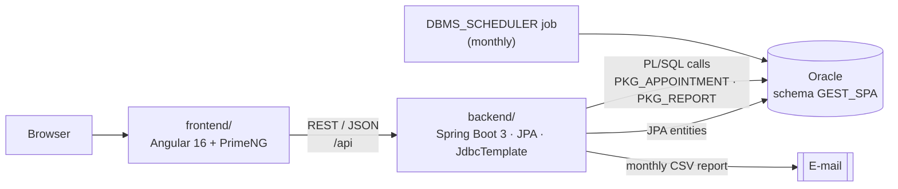
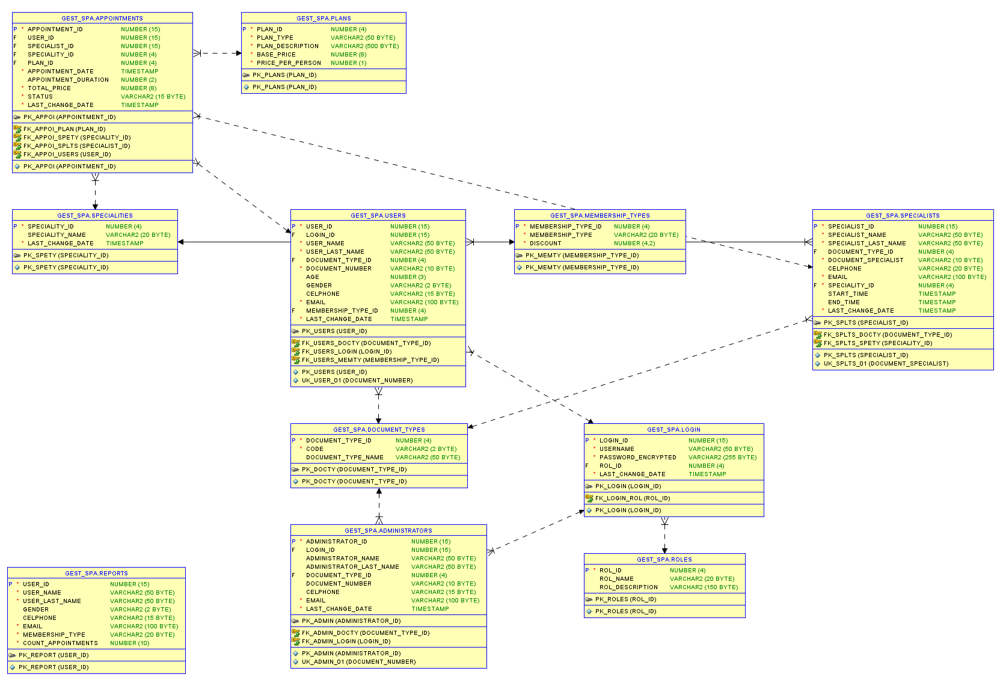

# Spa Belleza — Appointment Management System

Full-stack web application for a beauty spa. Clients log in, browse service plans priced by their membership tier and book appointments in the time slots that specialists actually have free. Administrators manage the agenda, load appointments in bulk from CSV and download a monthly client report.

[](https://github.com/GPaolaR/spa-belleza-fullstack/actions/workflows/ci.yml)
[](https://codespaces.new/GPaolaR/spa-belleza-fullstack)


> 🇪🇸 **Resumen:** Aplicación full-stack para la gestión de citas de un spa. Los clientes inician sesión, ven planes con descuento según su membresía y agendan citas en los horarios en que hay especialistas disponibles. Los administradores gestionan la agenda (filtros, cancelación), cargan citas masivamente desde CSV y descargan un reporte mensual de clientes. Front en Angular 16 + PrimeNG, API REST en Spring Boot 3 (Java 17) y base de datos Oracle con paquetes PL/SQL, tipos de objeto y un job programado con `DBMS_SCHEDULER`.

---

## Features

**Client**
- Login by role (client / administrator).
- Plans carousel with the price already discounted by the client's membership (Platinum, Gold, Silver).
- Booking: choose plan, treatment type, number of people and date; the API computes the **available time slots** from each specialist's working hours and existing appointments (including plans that need two specialties at once).
- Appointment history.

**Administrator**
- Agenda with filters by specialist, client, plan and date range, backed by the PL/SQL package `PKG_APPOINTMENT`, with appointment cancellation (the API also supports editing).
- Specialist schedules.
- **Bulk load** of appointments from a CSV file, with validation of each row.
- **Monthly report** of clients and number of appointments: built by `PKG_REPORT` (run monthly by an Oracle `DBMS_SCHEDULER` job), downloadable as CSV and sent by e-mail by a scheduled Spring task.

## Architecture



| Layer | Folder | Highlights |
|---|---|---|
| Frontend | [`frontend/`](frontend) | Lazy-loaded modules per role (`auth`, `user`, `admin`), reactive forms, HTTP interceptor, PrimeNG components |
| Backend | [`backend/`](backend) | Controller → service → repository layers, DTOs, JPQL constructor queries, `SimpleJdbcCall` to PL/SQL with Oracle object types, scheduled tasks, CSV upload/download, mail |
| Database | [`database/`](database) | One script per object (tables, sequences, indexes, FKs, object types, packages, job), deploy and rollback scripts, seed data |

## Data model



([PDF version](docs/relational-model.pdf))

## API

| Area | Endpoints |
|---|---|
| Auth | `POST /api/login/validate` |
| Users / admins | `GET /api/user/list`, `GET /api/user/us/{loginId}`, `GET /api/admin/us/{loginId}` |
| Plans | `GET /api/plans/list`, `GET /api/plans/{membershipTypeId}` (discounted prices) |
| Specialists | `GET /api/specialist/list`, `GET /api/specialist/schedule` |
| Appointments | `POST /api/appointments/get-agenda` (PL/SQL), `GET /available-time-slots`, `GET /available-time-slots-by-speciality`, `GET /calculate-start-date`, `POST /insert`, `PUT /edit`, `PUT /cancel`, `POST /upload` (CSV) |
| Reports | `GET /api/report/execute-process`, `GET /api/report/get-report`, `GET /api/report/download-csv` |

## Repository structure

```
.
├── frontend/              Angular app (modules: auth, user, admin, shared)
├── backend/               Spring Boot API
│   └── src/main/java/com/spabelleza/gestion_spa/
│       ├── controller/  service/  repository/
│       └── entity/  DTO/  exception/
├── database/
│   ├── APLICASYS_GEST_SPA.sql   run as SYS: tablespace + schema user
│   ├── APLICA_GEST_SPA.sql      run as GEST_SPA: all objects, seed data and job, in order
│   ├── tables/ sequences/ indexes/ references/ types/ packages/
│   ├── sql/                     seed data (fictitious) and scheduler job
│   ├── rollback/                drop scripts
│   ├── scripts/                 schema setup and package tests
│   └── docker/                  Linux setup script (CI + Codespaces)
├── docs/                  relational model
├── .devcontainer/         Codespaces / dev container
└── .github/workflows/     CI
```

## Run it in the browser (no installs)

Click **Open in GitHub Codespaces** above. The dev container comes with Java 17, Node 18 and an Oracle XE database that is created and filled with sample data on first start ([`database/docker/setup_gest_spa.sh`](database/docker/setup_gest_spa.sh)). Then, in two terminals:

```bash
cd backend && ./gradlew bootRun     # API on :8080
cd frontend && npm start            # app on :4200
```

Sample users (fictitious seed data): `USUARIO1` / `contra123` (client) and `Admin1` / `admin123` (administrator).

## Continuous integration

Every push runs [GitHub Actions](.github/workflows/ci.yml):

- **Frontend:** `npm ci` + production `ng build`.
- **Database + backend:** starts Oracle XE in Docker, applies the same scripts as `APLICA_GEST_SPA.sql` (failing if the PL/SQL packages do not compile), then runs `./gradlew build`. The Spring context test boots against the real schema with `ddl-auto=validate`, so any mismatch between JPA entities and tables fails the build.

## Running locally

**Requirements:** Oracle Database XE 21c, Java 17, Node.js 18+.

### 1. Database
With Docker, the quickest path is the same one CI uses:
```bash
docker run -d --name oracle -p 1521:1521 -e ORACLE_PASSWORD=system_pw \
  -v "$PWD/database:/database:ro" gvenzl/oracle-xe:21-slim-faststart
# wait until `docker logs oracle` shows "DATABASE IS READY TO USE!", then:
docker exec -e ORACLE_PASSWORD=system_pw -e DB_PASSWORD=your_password oracle bash /database/docker/setup_gest_spa.sh
```
On a Windows Oracle XE install, the original scripts also work: run `APLICASYS_GEST_SPA.sql` as SYS (edit the `CHANGE_ME` password first), then `APLICA_GEST_SPA.sql` as GEST_SPA.

### 2. Backend
Credentials are read from environment variables (see [`backend/.env.example`](backend/.env.example)):
```bash
cd backend
export DB_PASSWORD=your_password   # PowerShell: $env:DB_PASSWORD="your_password"
./gradlew bootRun                  # http://localhost:8080
```
`MAIL_USERNAME` / `MAIL_PASSWORD` (a Gmail account and app password) are only needed for the monthly report e-mail.

### 3. Frontend
```bash
cd frontend
npm install
npm start                          # http://localhost:4200, /api is proxied to :8080
```

## Known limitations & next steps

This was a time-boxed bootcamp project (Sep–Dec 2023); these are the improvements I would make next:

- **Security:** passwords are stored and compared in plain text. Next step: hash with BCrypt and issue JWTs with Spring Security.
- **SQL:** the agenda package builds its query by string concatenation; switch to bind variables.
- **Tests:** add unit tests for the availability logic and integration tests for the PL/SQL packages; the generated Angular `.spec.ts` files still need their test modules configured.
- **Config:** the dev server proxies `/api` to the backend; a production deployment needs the same reverse-proxy rule, and the per-controller `@CrossOrigin` annotations should become a single CORS config.

## Author

**Gina Riveros**: [GitHub](https://github.com/GPaolaR)
